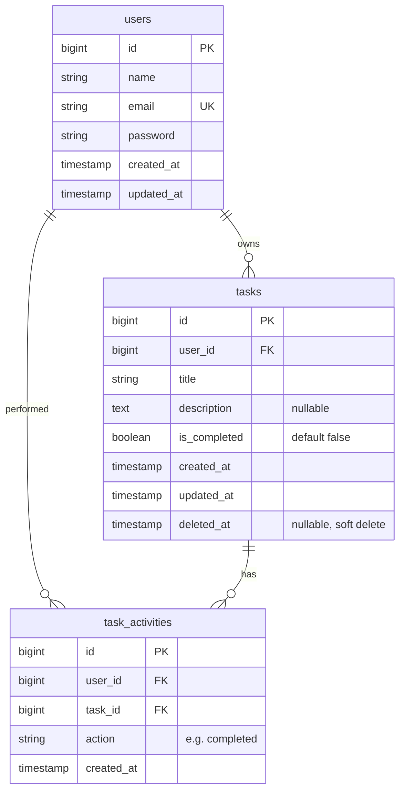

# TaskFlow — Task Management System

A full-stack task manager built with **Laravel 13** (REST API) and a **Vue 3** single-page app. Users register, sign in and manage their own tasks: create, edit, complete, search, filter, soft-delete, restore and permanently delete. Completing a task fires a domain event, and a queued listener records it in an activity feed shown on the dashboard.

- **Repository:** _to be added_
- **Live demo:** _to be added_

---

## Contents

1. [Features](#features)
2. [Tech stack](#tech-stack)
3. [Architecture](#architecture)
4. [Project structure](#project-structure)
5. [Database schema](#database-schema)
6. [Getting started](#getting-started)
7. [Running the app](#running-the-app)
8. [Testing](#testing)
9. [API reference](#api-reference)
10. [Security notes](#security-notes)
11. [Screenshots](#screenshots)
12. [Known limitations](#known-limitations)

---

## Features

**Authentication**
- Register, sign in (with "remember me") and sign out
- Cookie-based session auth through Sanctum's SPA mode, so no tokens are kept in `localStorage`
- Login throttled per email + IP (5 failed attempts), registration throttled per IP (5/min)
- Route guards in the SPA, with a safe `?redirect=` back to the page the user wanted

**Tasks**
- Create, view, edit and delete tasks (title up to 255 chars, optional description up to 5,000)
- One-click completion toggle with optimistic UI and rollback on failure
- Server-side search by title, status filter (all / pending / completed) and pagination (10 per page)
- Statistics: total, completed, pending, trashed and completion rate
- Soft delete with an **Undo** toast, a Trash page to restore tasks or delete them permanently
- "Recent activity" feed, written by a queued listener when a task is completed

**UI**
- Responsive layout with a mobile navigation drawer
- Loading skeletons, empty states, error states with retry, and toast notifications
- Accessible modals (focus trap, Escape to close, focus return), labelled controls, and native radio buttons for the filters
- Respects `prefers-reduced-motion`

---

## Tech stack

| Layer | Choice |
|---|---|
| Backend | PHP 8.3, Laravel 13, Laravel Sanctum 4 (SPA cookie auth) |
| Database | MySQL 8.4 (SQLite in-memory for the test suite) |
| Queue | Laravel database queue |
| Frontend | Vue 3.5 (`<script setup>`), Vue Router 4, Axios, Tailwind CSS 4, Vite 7 |
| Testing | PHPUnit 12, Vitest + Vue Test Utils + jsdom |
| Code style | Laravel Pint |

No state-management library is used. The shared state is small enough for module-level composables (`useAuth`, `useToast`), and a store would be ceremony here.

---

## Architecture

### Request flow

```
Vue page ──► service (axios) ──► routes/api.php ──► auth:sanctum
                                                     │
                                         TaskPolicy (can: middleware)
                                                     │
                                       FormRequest (validation)
                                                     │
                                  Controller ──► Action / TaskService ──► Eloquent
                                                     │
                                         API Resource (JSON response)
```

Authorization runs as `can:` controller middleware, **before** validation, so a request for someone else's task gets a `403` and never learns anything from validation errors.

### Actions vs. TaskService

The code uses both patterns, each for what it's good at:

- **Actions** (`app/Actions`) are single-purpose operations with one `execute()` method: create, update, delete, restore, force-delete and toggle. Controllers call them directly. Wrapping each one in a service method would just add a pass-through layer.
- **`TaskService`** holds the logic that coordinates several steps or that queries need to share:
  - paginated listing with filters
  - trash listing
  - statistics, computed in a single `SUM(CASE …)` query
  - recent activity
  - the completion toggle

The toggle runs in a transaction with `lockForUpdate()`, so two rapid clicks can't both fire `TaskCompleted`.

No repository layer or interfaces were added. Eloquent already acts as the repository, and there's only one implementation of anything.

### Events and queue

```
Task::updated (is_completed false → true)
        └─► TaskCompleted event (ShouldDispatchAfterCommit)
                └─► RecordTaskCompletedActivity (ShouldQueue) ─► task_activities row
```

- The event is dispatched from the model's `updated` hook, so it fires whether a task is completed via the toggle endpoint or via a regular update.
- `ShouldDispatchAfterCommit` stops a rolled-back transaction from leaving behind a queued job for a change that never happened.
- If the task is force-deleted before the job runs, `#[DeleteWhenMissingModels]` drops the job instead of letting it fail.

### Frontend

- `services/api.js` is a single Axios instance with `withCredentials` and `withXSRFToken`. Its response interceptor:
  - on a **419** (expired CSRF token), fetches a fresh CSRF cookie and retries the request once;
  - on a **401**, clears the user and sends them to the login page;
  - turns every error into one shape, `{ message, status, errors }`, and never shows server internals for 5xx responses.
- `composables/useTasks.js` owns the dashboard state:
  - filters are watched, and search is debounced by 300 ms;
  - responses that arrive after a newer request are dropped, so fast typing can't show stale results;
  - if a deletion empties the last page, the page number is corrected.
- Pages are lazy-loaded per route.

---

## Project structure

```
app/
├── Actions/            Single-purpose operations (Auth/, Task/)
├── Enums/              TaskStatus (all | pending | completed)
├── Events/             TaskCompleted
├── Http/
│   ├── Controllers/Api AuthController, TaskController, TaskActivityController
│   ├── Requests/       Login, Register, ListTasks, StoreTask, UpdateTask
│   └── Resources/      User, Task, TaskActivity
├── Listeners/          RecordTaskCompletedActivity (queued)
├── Models/             User, Task, TaskActivity
├── Policies/           TaskPolicy
└── Services/           TaskService
database/
├── factories/          UserFactory, TaskFactory
├── migrations/
└── seeders/            Demo user with realistic tasks
resources/js/
├── components/
│   ├── common/         BaseButton, BaseInput, BaseModal, PaginationNav, Toasts…
│   ├── layout/         AppLayout, AuthLayout, Sidebar, AppHeader
│   └── tasks/          TaskList, TaskItem, TaskForm, TaskFilters, TaskStatistics…
├── composables/        useAuth, useTasks, useToast
├── pages/              Login, Register, Dashboard, TaskDetail, Trash
├── router/             Routes and auth guard
├── services/           api (axios), authService, taskService
└── utils/              date formatting, debounce, safe redirect
routes/
├── api.php             REST API
└── web.php             Catch-all that serves the SPA shell
tests/
├── Feature/            Auth, task CRUD, filtering, trash, completion, statistics, SPA shell
└── Unit/               TaskPolicy
```

---

## Database schema



**Indexes:**
- `tasks (user_id, is_completed)` serves the status filter and the statistics.
- `tasks (user_id, deleted_at)` serves the main list and the trash.
- `task_activities (user_id, created_at)` serves the activity feed.

There's no separate `user_id` index: the composite indexes lead with `user_id`, so MySQL uses them for the foreign key too. Title search uses a leading-wildcard `LIKE`, which a B-tree index can't use, so `title` isn't indexed.

**Foreign keys** cascade on delete: removing a user removes their tasks, and force-deleting a task removes its activity rows.

---

## Getting started

### Requirements

- PHP 8.3+ with `pdo_mysql` (and `pdo_sqlite` for the tests)
- Composer 2
- Node.js 22 or 24 LTS (Vitest 5 needs 22.12+; jsdom 31 declares 22.22+ / 24.15+)
- MySQL 8

The project was developed on [Laragon](https://laragon.org/) (Windows) but has nothing Laragon-specific in it.

### Installation

```bash
git clone <repository-url> moneta-assessment
cd moneta-assessment

composer install
npm install

cp .env.example .env        # Windows PowerShell: Copy-Item .env.example .env
php artisan key:generate
```

### Environment

Create the database, then check these values in `.env`:

| Key | Default | Notes |
|---|---|---|
| `APP_URL` | `http://moneta-assessment.test` | The URL you'll open in the browser |
| `DB_DATABASE` | `moneta_assessment` | Create it first: `CREATE DATABASE moneta_assessment;` |
| `DB_USERNAME` / `DB_PASSWORD` | `root` / _(empty)_ | Laragon defaults |
| `SANCTUM_STATEFUL_DOMAINS` | `moneta-assessment.test,localhost,localhost:8000,127.0.0.1,127.0.0.1:8000` | **Must include the host you browse from**, or every API call returns 401 |
| `SESSION_DOMAIN` | `null` | Leave as is when the SPA and API share a host |
| `QUEUE_CONNECTION` | `database` | Use `sync` to skip the worker; the activity feed then updates instantly |

### Migrate and seed

```bash
php artisan migrate --seed
```

The seeder creates:

| Email | Password | Data |
|---|---|---|
| `demo@example.com` | `password` | 15 tasks (6 completed, with activity history) and 3 in the trash |
| `other@example.com` | `password` | 5 tasks, handy for checking that users can't see each other's data |

---

## Running the app

### Option A — one command

```bash
composer dev
```

This runs the PHP server (http://localhost:8000), the queue worker and the Vite dev server together.

### Option B — separately

```bash
php artisan serve        # or use the Laragon virtual host
php artisan queue:work   # needed for the "Recent activity" feed
npm run dev              # or `npm run build` once for production assets
```

**Laragon:** with the project in `C:\laragon\www\moneta-assessment`, click **Reload** in Laragon to create the `moneta-assessment.test` virtual host, then run `npm run build` (or `npm run dev`) and the queue worker.

### Production build

```bash
npm run build
php artisan optimize
```

Set `APP_ENV=production` and `APP_DEBUG=false`. In production the password rules also require mixed case and numbers, and passwords are checked against known breaches.

---

## Testing

### Backend (PHPUnit)

```bash
php artisan test
```

This runs **73 tests / 258 assertions** against an in-memory SQLite database. You don't need any setup, and the queue runs synchronously.

To run the same suite against MySQL, create an empty database and override the connection:

```bash
# bash
DB_CONNECTION=mysql DB_DATABASE=moneta_assessment_testing php artisan test

# PowerShell
$env:DB_CONNECTION='mysql'; $env:DB_DATABASE='moneta_assessment_testing'; php artisan test
```

**What's covered:**
- **Registration and login:** validation, throttling (429 on the 6th failed attempt) and logout.
- **Protected endpoints:** a guest gets 401 on all 13.
- **Task CRUD:** includes ignoring an injected `user_id`.
- **Cross-user access:** 403 on every route.
- **Filtering, search and pagination:** includes `%` and `_` searched as literal characters, and pagination links that keep the active filters.
- **Trash:** restore and force delete, and 409 when the task isn't in the trash.
- **The completion event:** fired only on a false → true change, plus the activity feed and statistics.
- **The policy** (unit-tested) and **the SPA catch-all route**.

### Frontend (Vitest)

```bash
npm test
```

This runs **21 tests** for:
- `TaskForm`: validation, trimming, create vs. edit payloads and server errors;
- `TaskFilters`: the v-model contract, counts and the clear button;
- the `safeRedirect` open-redirect guard.

### Code style

```bash
vendor/bin/pint --test
```

---

## API reference

Base URL is `/api`. Every endpoint returns JSON. All task endpoints need an authenticated session and only ever act on the current user's tasks.

### Authenticating from Postman / curl

Sanctum's SPA mode uses cookies and CSRF, not bearer tokens. Your client has to:

1. `GET /sanctum/csrf-cookie` and keep the cookies it returns (`XSRF-TOKEN` and the session cookie).
2. Send every request with:
   - `Accept: application/json`
   - `Referer: http://localhost:8000`, or another host from `SANCTUM_STATEFUL_DOMAINS`
   - `X-XSRF-TOKEN: <URL-decoded value of the XSRF-TOKEN cookie>`
3. `POST /api/login`, then keep sending the cookies.

```bash
curl -c jar -b jar http://localhost:8000/sanctum/csrf-cookie
# the cookie is URL-encoded base64; the header wants it decoded
TOKEN=$(grep XSRF-TOKEN jar | awk '{print $7}' | sed -e 's/%3D/=/g' -e 's/%2B/+/g' -e 's/%2F/\//g')

curl -c jar -b jar -X POST http://localhost:8000/api/login \
  -H "Accept: application/json" -H "Content-Type: application/json" \
  -H "Referer: http://localhost:8000" -H "X-XSRF-TOKEN: $TOKEN" \
  -d '{"email":"demo@example.com","password":"password"}'

curl -b jar http://localhost:8000/api/tasks?status=pending \
  -H "Accept: application/json" -H "Referer: http://localhost:8000"
```

### Endpoints

| Method | Path | Description | Success |
|---|---|---|---|
| POST | `/register` | Create an account and sign in (throttled 5/min per IP) | 201 |
| POST | `/login` | Sign in (`email`, `password`, optional `remember`) | 200 |
| POST | `/logout` | Sign out and invalidate the session | 204 |
| GET | `/user` | Current user | 200 |
| GET | `/tasks` | Paginated list (see query parameters below) | 200 |
| POST | `/tasks` | Create a task | 201 |
| GET | `/tasks/{id}` | Show a task | 200 |
| PUT/PATCH | `/tasks/{id}` | Update a task (only the fields sent are changed) | 200 |
| DELETE | `/tasks/{id}` | Soft delete (move to trash) | 204 |
| PATCH | `/tasks/{id}/toggle-completion` | Flip `is_completed` | 200 |
| GET | `/tasks/statistics` | Totals for the current user | 200 |
| GET | `/tasks/trash` | Paginated trashed tasks (`search`, `page`, `per_page`) | 200 |
| POST | `/tasks/{id}/restore` | Restore a trashed task | 200 |
| DELETE | `/tasks/{id}/force-delete` | Permanently delete a trashed task | 204 |
| GET | `/activities` | Latest completion activity (8 items) | 200 |

**`GET /tasks` query parameters:**
- `search`: title contains, up to 255 characters.
- `status`: `all`, `pending` or `completed`.
- `per_page`: 1–50, default 10.
- `page`: the page number.

### Request body (create / update)

```json
{
  "title": "Prepare sprint demo",
  "description": "Five minute walkthrough of the filters.",
  "is_completed": false
}
```

**Field rules:**
- `title`: required on create, max 255 characters.
- `description`: nullable, max 5,000 characters.
- `is_completed`: optional boolean.

A `user_id` in the body is ignored; the owner always comes from the session.

### Responses

A single task:

```json
{
  "data": {
    "id": 12,
    "title": "Prepare sprint demo",
    "description": "Five minute walkthrough of the filters.",
    "is_completed": false,
    "created_at": "2026-11-16T09:40:12+00:00",
    "updated_at": "2026-11-16T09:40:12+00:00",
    "deleted_at": null
  }
}
```

List endpoints wrap `data` with Laravel's standard `links` and `meta` (`current_page`, `last_page`, `per_page`, `total`, `from`, `to`). The pagination links keep the active filters.

Statistics:

```json
{ "data": { "total": 15, "completed": 6, "pending": 9, "trashed": 3 } }
```

### Errors

| Status | When | Body |
|---|---|---|
| 401 | Not signed in | `{ "message": "Unauthenticated." }` |
| 403 | Task belongs to another user | `{ "message": "This action is unauthorized." }` |
| 404 | Unknown task or route | `{ "message": "Resource not found." }` |
| 409 | Restore / force-delete on a task that isn't in the trash | `{ "message": "Only tasks in the trash can be restored." }` |
| 419 | Missing or expired CSRF token | `{ "message": "CSRF token mismatch." }` |
| 422 | Validation failed | `{ "message": "…", "errors": { "title": ["…"] } }` |
| 429 | Too many login / register attempts | `{ "message": "…" }` |

---

## Security notes

- **Sessions:** cookie-based (httpOnly). The session ID is regenerated on login and registration, and invalidated on logout.
- **CSRF:** enforced on every state-changing request through Sanctum's stateful middleware.
- **Ownership:** every task query is scoped to the authenticated user, and `TaskPolicy` checks ownership on every route that takes a `{task}`. `user_id` is never mass-assignable.
- **Search:** the search term is LIKE-escaped, so `%` and `_` match literally and can't widen the query.
- **No information leaks:** 404 responses are generic, and 5xx details are never shown to users. With `APP_DEBUG=false`, Laravel doesn't send them either.
- **Login redirects:** `?redirect=` after sign-in only follows in-app paths, which blocks open redirects such as `//evil.example`.
- **Rate limits:** login and registration are rate-limited. Passwords are hashed with bcrypt, and production uses stricter rules.

---

## Screenshots

> _Placeholders. Add images to `docs/screenshots/` before submission._

| Screen | File |
|---|---|
| Sign in | `docs/screenshots/login.png` |
| Dashboard | `docs/screenshots/dashboard.png` |
| Task details | `docs/screenshots/task-detail.png` |
| Trash | `docs/screenshots/trash.png` |
| Mobile | `docs/screenshots/mobile.png` |

---

## Known limitations

- **The activity feed depends on the queue worker.** Without `php artisan queue:work`, or `QUEUE_CONNECTION=sync`, completions are queued but don't show up in "Recent activity".
- **The dashboard refreshes the activity feed once, 1.5 s after a completion.** A slow worker means a manual reload. Real-time updates (broadcasting) were out of scope.
- **`npm audit` reports moderate advisories** in `js-beautify`, which `@vue/test-utils` pulls in. It's a dev/test-only dependency and isn't in the production bundle. The fix npm suggests is a downgrade, so it's left as is.
- **`composer dev` doesn't include `php artisan pail`.** Pail needs the `pcntl` extension, which isn't available on Windows. Logs are written to `storage/logs/laravel.log`.
